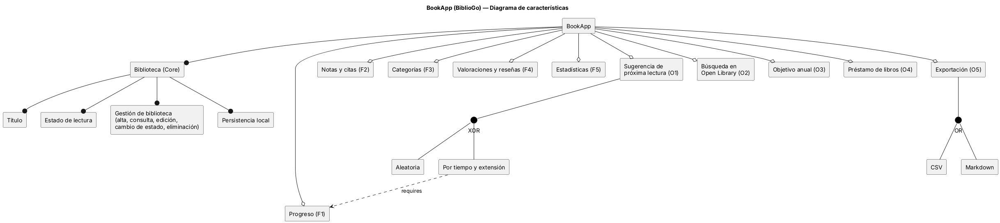

# Sesión 3 — Modelo de características de BookApp (BiblioGo)

**Equipo:** Sergio Alías García, Hugo César Sánchez, Arturo Rodríguez Pérez, Javier Campuzano García, Iván Ortega Recena

## 1. Diagrama de características



Fuente PlantUML: [FEATURE_MODEL.puml](FEATURE_MODEL.puml)

| Tipo | Característica | Contenido |
|---|---|---|
| Obligatorio | **Biblioteca (Core)** | Libro con identificador, título no vacío, autor opcional y estado de lectura; alta, consulta, edición, cambio de estado y eliminación; persistencia local |
| Opcional | F1 Progreso | Total de páginas, página actual y porcentaje leído |
| Opcional | F2 Notas y citas | Anotaciones personales vinculadas a un libro |
| Opcional | F3 Categorías | Clasificación de libros y filtrado de la biblioteca |
| Opcional | F4 Valoraciones y reseñas | Puntuación de 1 a 5 estrellas y reseña personal |
| Opcional | F5 Estadísticas | Número total de libros y recuento por estado |
| Opcional | O1 Sugerencia de próxima lectura | Propone un libro de la lista de pendientes. Grupo **XOR**: Aleatoria o Por tiempo y extensión |
| Opcional | O2 Búsqueda en Open Library | Busca por título o ISBN y rellena el alta del libro |
| Opcional | O3 Objetivo anual | Meta de libros terminados en el año y su avance |
| Opcional | O4 Préstamo de libros | Registra a quién se ha prestado un libro y si se ha devuelto |
| Opcional | O5 Exportación | Exporta la biblioteca. Grupo **OR**: CSV y/o Markdown |

El autor es un atributo del Core que puede estar vacío, no una característica. F1–F5 y O1–O5 son hijas opcionales e independientes de la raíz; no forman un grupo OR, así que existe la variante con solo el Core.

## 2. Por qué estas características originales

- **O1 Sugerencia de próxima lectura** es la propuesta de valor de nuestra visión: resolver qué leer a continuación.
- **O2 Búsqueda en Open Library** recupera la búsqueda en catálogo externo de nuestro MVP de la sesión 2.
- **O3 Objetivo anual** refuerza la constancia sin métricas obsesivas, como pide la visión.
- **O4 Préstamo de libros** cubre a quien tiene biblioteca física.
- **O5 Exportación** permite sacar los datos de la app sin cuenta de usuario.

Descartamos el temporizador de lectura porque la visión rechaza expresamente la presión de los temporizadores.

## 3. Grupos y restricciones

| Elemento | Tipo | Justificación |
|---|---|---|
| Estrategia de O1 | XOR | Una variante sugiere de una sola forma; dos estrategias a la vez darían resultados contradictorios en la misma pantalla |
| Formato de O5 | OR | Exportar sin ningún formato no tiene sentido; ofrecer varios a la vez sí |
| Por tiempo y extensión **requires** F1 | requires | Para filtrar por extensión o tiempo hace falta el total de páginas, que solo existe en F1 |

Relaciones que **no** son restricciones:

- **F5 no requiere F1.** El total de libros y el recuento por estado se calculan con datos del Core.
- **O3 no requiere F1.** El objetivo cuenta libros en estado Terminado.
- **O2 y F1.** Si la variante incluye F1, la búsqueda rellena también el total de páginas. Sin F1 ese dato se ignora, así que es una interacción, no una restricción.
- No hemos encontrado ningún `excludes` justificado entre características.
- La persistencia local es obligatoria y, de momento, sin alternativas: no copiamos el XOR JSON / Core Data de TaskApp.

## 4. Comprobación de variantes

| Variante | Características | ¿Válida? |
|---|---|---|
| Base | Solo el Core | Sí: todas las demás son opcionales |
| Común | Core + F1–F5 | Sí: no activa O1 ni O5, así que no hay grupos que cumplir |
| Completa | Core + F1–F5 + O1 (Por tiempo y extensión) + O2–O5 (CSV y Markdown) | Sí: XOR con una estrategia, OR con al menos un formato y F1 presente |
| Ejemplo inválido | Core + O1 (Por tiempo y extensión) sin F1 | No: incumple el `requires` |

## 5. Arquitectura MVVM

Seguimos la misma estructura que el ejemplo TaskApp del profesor: la carpeta `BookApp/` la compilan tanto Xcode (`BookApp.xcodeproj`) como Swift Package Manager (`Package.swift`, en Linux y Windows).

```
BookApp/
├── Application/
│   ├── BookApp.swift              // @main, ventana con Biblioteca y Ajustes
│   ├── AppConfig.swift            // feature flags en ejecución
│   └── Theme.swift                // colores, iconos y estilos
├── Core/
│   ├── Models/                    // Book, ReadingStatus
│   ├── ViewModels/                // BookListViewModel
│   └── Views/                     // BookListView, BookRowView, BookDetailView
├── Features/
│   ├── Progress/                  // F1: ReadingProgress y su sección del detalle
│   └── Settings/                  // pantalla de Ajustes
└── Infrastructure/
    └── Persistence/               // StorageProvider, JSON y Mock
```

- **Model:** `Book` y `ReadingStatus` en el Core. F1 tiene su propio tipo, `ReadingProgress`, enlazado al libro por `bookID`, para que `Book` no dependa de ninguna feature. Las features F2–F5 y las originales tendrán su carpeta en `Features/` cuando se implementen.
- **View:** `BookListView`, `BookRowView` y `BookDetailView` solo dibujan y comunican acciones. `BookRowView` ni siquiera conoce el ViewModel: recibe los datos, los flags y la acción.
- **ViewModel:** **`BookListViewModel` es el responsable del listado y de modificar el estado de los libros**: alta, edición, cambio de estado, eliminación y guardado mediante `StorageProvider`.

## 6. Reparto

Cada persona tiene una característica común y una original relacionada, para reducir dependencias entre compañeros.

| Integrante | Común | Original |
|---|---|---|
| Sergio Alías García | F1 Progreso | O1 Sugerencia de próxima lectura |
| Hugo César Sánchez | F2 Notas y citas | O5 Exportación |
| Arturo Rodríguez Pérez | F3 Categorías | O2 Búsqueda en Open Library |
| Javier Campuzano García | F4 Valoraciones y reseñas | O4 Préstamo de libros |
| Iván Ortega Recena | F5 Estadísticas | O3 Objetivo anual |
